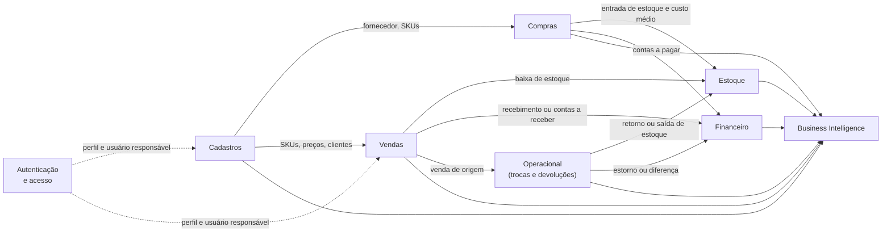
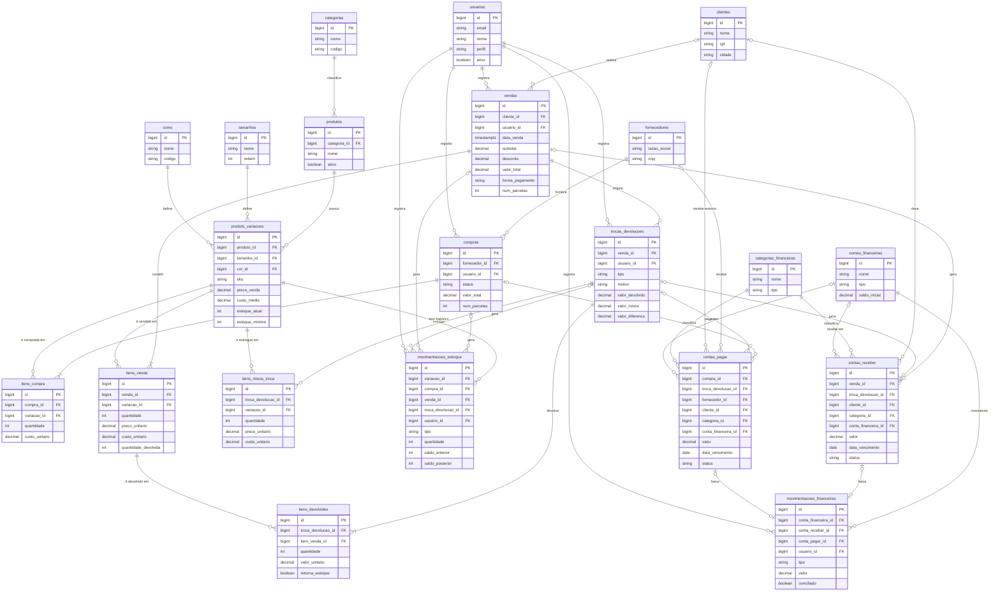
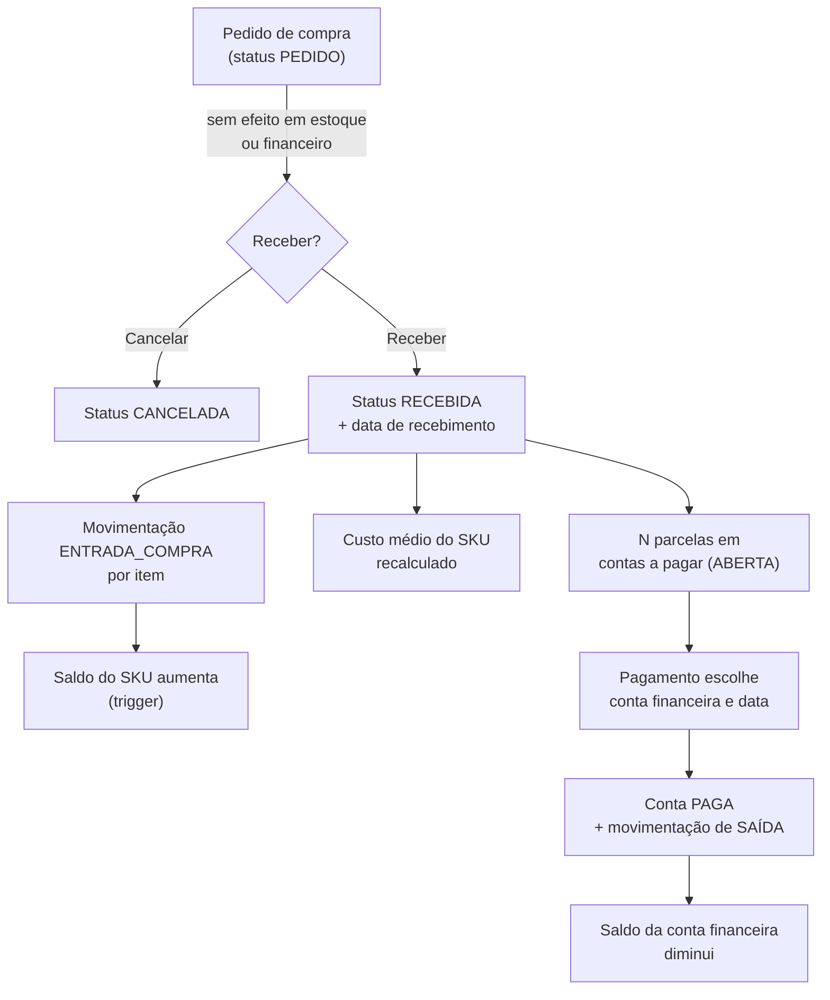
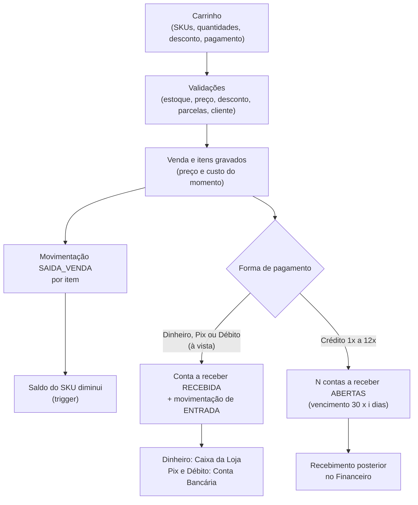
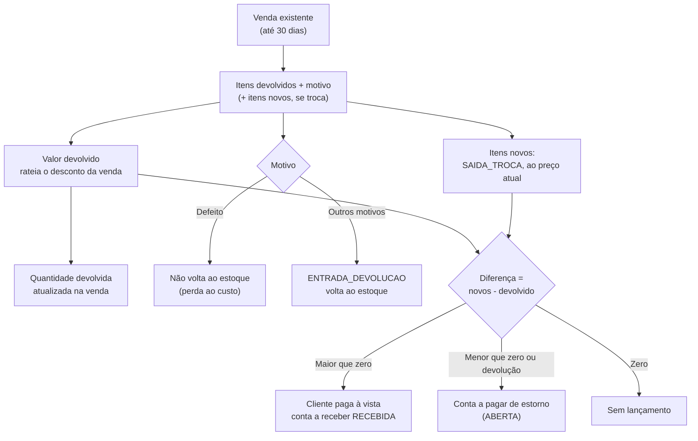

# GestWear ERP: Documentação

Documentação do sistema GestWear ERP, organizada em duas partes:

- **Parte 1: Documentação do sistema (ERP)**: descrição, módulos, modelo de dados, integração entre módulos e regras de negócio.
- **Parte 2: Documentação de Business Intelligence (BI)**: descrição dos indicadores do dashboard.

## Sumário

**Parte 1: Sistema (ERP)**
1. [Descrição do sistema](#1-descrição-do-sistema)
2. [Descrição dos módulos](#2-descrição-dos-módulos)
3. [Modelo de dados](#3-modelo-de-dados)
4. [Integração entre módulos](#4-integração-entre-módulos)
5. [Regras de negócio](#5-regras-de-negócio)

**Parte 2: Business Intelligence**
1. [Descrição dos indicadores](#parte-2-1-descrição-dos-indicadores)

---

# Parte 1: Documentação do sistema (ERP)

## 1. Descrição do sistema

### 1.1 Contextualização

O GestWear ERP é um sistema de informação para uma **loja de roupas de varejo, de loja única**. Foi desenvolvido como trabalho da disciplina **Sistemas de Informação e Tecnologias**, do curso de **Bacharelado em Ciência da Computação** (UFAPE).

O varejo de vestuário tem características que tornam o controle manual frágil:

- cada produto existe em várias combinações de **tamanho e cor**, e cada combinação tem estoque, preço e custo próprios;
- as vendas podem ser **parceladas no crédito**, o que cria contas a receber e risco de inadimplência;
- **trocas e devoluções** são frequentes e alteram estoque e caixa ao mesmo tempo;
- o custo das mercadorias varia a cada compra, o que afeta a margem;
- o gestor precisa enxergar vendas, estoque e finanças em conjunto para decidir o que comprar, quanto descontar e quando pagar.

O sistema reúne essas operações em uma única base de dados, de modo que cada operação em um módulo atualiza automaticamente os demais.

### 1.2 Objetivo do sistema

Apoiar a operação e a gestão da loja, integrando cadastros, compras, estoque, vendas, trocas e devoluções e finanças, e oferecer um painel de Business Intelligence que transforma esses dados em indicadores para a tomada de decisão.

Objetivos específicos:

- manter o estoque sempre consistente com compras, vendas e devoluções, com histórico rastreável;
- registrar o impacto financeiro de cada operação (contas a pagar, contas a receber e movimentação de caixa e bancos);
- garantir a integridade dos dados por meio de regras de negócio e restrições no banco;
- controlar o acesso por perfil de usuário;
- disponibilizar indicadores calculados diretamente do banco de dados, sem dados externos ou simulados.

### 1.3 Escopo das funcionalidades implementadas

| Módulo | Funcionalidades implementadas |
|---|---|
| Autenticação e controle de acesso | Login com conta Google; acesso restrito a e-mails cadastrados e ativos; perfis Admin, Gerente e Vendedor; menu e telas por perfil; cadastro e manutenção de usuários |
| Cadastros | Produtos com variações (tamanho e cor) e geração automática de SKU; clientes; fornecedores; tabelas auxiliares (categorias, tamanhos e cores); inativação em vez de exclusão |
| Compras | Pedido de compra (criar, editar, cancelar); recebimento com entrada de estoque, recálculo do custo médio e geração de parcelas a pagar |
| Estoque | Posição por SKU; histórico de movimentações; alerta de reposição; ajuste de inventário com motivo |
| Vendas | Venda de balcão com carrinho; desconto; pagamento em dinheiro, Pix, débito e crédito (até 12x); baixa de estoque e lançamento financeiro automáticos; histórico e detalhe |
| Operacional | Trocas e devoluções sobre vendas dos últimos 30 dias; retorno ao estoque conforme o motivo; estorno ou cobrança da diferença |
| Financeiro | Contas a pagar (inclusive despesas avulsas parceladas); contas a receber; caixa e bancos; extrato; fluxo de caixa realizado e projetado; conciliação |
| Business Intelligence | Dashboard com cinco abas, filtro de período, comparação com o período anterior e análises temporais, comparativas e gerenciais |

**Limites do escopo (não implementado):**

- emissão de documentos fiscais (NF-e, NFC-e) e cálculo de tributos;
- mais de uma loja ou filial;
- venda online e integração com meios de pagamento ou bancos (a conciliação é feita manualmente pelo usuário);
- cancelamento de venda (a correção é feita por devolução);
- desfazer baixas de pagamento e recebimento.

### 1.4 Arquitetura e tecnologias

O código segue uma separação em camadas:

| Camada | Pasta | Responsabilidade |
|---|---|---|
| Interface | `views/` | Telas em Streamlit. Coleta dados, exibe resultados e mensagens. Não contém regra de negócio |
| Regras de negócio | `services/` | Validações, cálculos e operações que envolvem mais de uma tabela, sempre dentro de uma transação |
| Dados | `db/` e `database/` | Conexão com o PostgreSQL, esquema, restrições e gatilhos (triggers) |
| Apoio | `utils/` e `config.py` | Formatação, datas, cálculos e parâmetros de negócio |

| Item | Tecnologia |
|---|---|
| Aplicação e interface | Python e Streamlit |
| Banco de dados | PostgreSQL (Supabase) |
| Autenticação | Login com conta Google (OpenID Connect) |
| Publicação | Streamlit Community Cloud |
| Código-fonte | GitHub |

O fuso horário de exibição é `America/Recife`. O banco armazena data e hora com fuso (`timestamptz`).

---

## 2. Descrição dos módulos

### 2.1 Módulos e papel no sistema

| Módulo | Papel no sistema | Tabelas principais | Perfis com acesso |
|---|---|---|---|
| Autenticação e controle de acesso | Identifica quem usa o sistema e define o que cada perfil pode fazer | `usuarios` | Todos (cadastro de usuários: Admin) |
| Cadastros | Base de informações usada por todos os outros módulos: o que se vende (produtos e SKUs), para quem (clientes) e de quem se compra (fornecedores) | `categorias`, `tamanhos`, `cores`, `produtos`, `produto_variacoes`, `clientes`, `fornecedores` | Produtos: todos (Vendedor só consulta); clientes: todos; fornecedores e tabelas auxiliares: gestão |
| Compras | Repõe as mercadorias. O pedido não altera nada; o recebimento alimenta estoque, custo e contas a pagar | `compras`, `itens_compra` | Gestão |
| Estoque | Mantém o saldo de cada SKU e o histórico imutável de movimentações; emite alertas de reposição | `movimentacoes_estoque` e `produto_variacoes` (saldo) | Todos (ajuste de inventário: gestão) |
| Vendas | Registra a venda de balcão, baixa o estoque e lança o financeiro | `vendas`, `itens_venda` | Todos |
| Operacional | Trata trocas e devoluções de vendas já realizadas, com reflexo em estoque e financeiro | `trocas_devolucoes`, `itens_devolvidos`, `itens_novos_troca` | Todos |
| Financeiro | Controla o que a loja deve pagar e receber, o caixa e os bancos, o fluxo de caixa e a conciliação | `contas_pagar`, `contas_receber`, `contas_financeiras`, `categorias_financeiras`, `movimentacoes_financeiras` | Gestão |
| Business Intelligence | Consolida os dados dos demais módulos em indicadores e gráficos para a gestão | (somente leitura de todas as tabelas) | Gestão |

### 2.2 Relação entre os módulos

| Relação | Natureza |
|---|---|
| Cadastros → Compras, Vendas, Operacional | Fornecem os itens, preços e partes envolvidas. Registros inativos não entram em novas operações |
| Compras → Estoque | O recebimento gera `ENTRADA_COMPRA` e recalcula o custo médio do SKU |
| Compras → Financeiro | O recebimento gera as parcelas em contas a pagar |
| Vendas → Estoque | Cada venda gera `SAIDA_VENDA` na mesma transação |
| Vendas → Financeiro | Venda à vista gera recebimento imediato; venda no crédito gera contas a receber em aberto |
| Operacional → Vendas | Toda troca ou devolução parte de uma venda existente e atualiza a quantidade devolvida dos itens |
| Operacional → Estoque | Itens devolvidos voltam ao estoque (exceto defeito); itens novos da troca saem do estoque |
| Operacional → Financeiro | Gera conta a pagar de estorno ou conta a receber de diferença |
| Autenticação → todos | Define o que cada perfil acessa e grava o usuário responsável em cada operação |
| Todos → BI | O dashboard lê diretamente as tabelas dos módulos |

---

## 3. Modelo de dados

### 3.1 Modelo entidade-relacionamento (MER)

O modelo possui 21 tabelas, todas no PostgreSQL. A figura abaixo mostra as entidades, as chaves e os principais atributos. `PK` indica chave primária e `FK`, chave estrangeira.

### 3.2 Principais entidades

| Entidade | Descrição |
|---|---|
| `usuarios` | Pessoas autorizadas a entrar no sistema, com perfil (Admin, Gerente ou Vendedor) e situação |
| `categorias`, `tamanhos`, `cores` | Tabelas auxiliares que compõem o produto e o SKU (a categoria e a cor têm um código curto usado no SKU) |
| `produtos` | Modelo de peça (ex.: uma camiseta), vinculado a uma categoria |
| `produto_variacoes` | O **SKU**: combinação de produto, tamanho e cor, com preço de venda, custo médio, saldo de estoque e estoque mínimo. É a unidade de venda, compra e estoque |
| `clientes`, `fornecedores` | Partes envolvidas nas vendas e compras, com CPF (cliente) e CNPJ (fornecedor) únicos |
| `compras` e `itens_compra` | Pedido de compra a um fornecedor e seus itens, com status `PEDIDO`, `RECEBIDA` ou `CANCELADA` |
| `vendas` e `itens_venda` | Venda de balcão e seus itens. Cada item guarda o preço e o custo do momento da venda e a quantidade já devolvida |
| `trocas_devolucoes` | Operação pós-venda, com tipo (`TROCA` ou `DEVOLUCAO`), motivo e valores devolvido, de itens novos e diferença |
| `itens_devolvidos` e `itens_novos_troca` | Itens que voltam (com indicação de retorno ao estoque) e itens entregues na troca |
| `movimentacoes_estoque` | Histórico imutável de entradas, saídas e ajustes, com saldo anterior e posterior, origem e responsável |
| `contas_financeiras` | Caixa e bancos onde o dinheiro entra e sai, com saldo inicial |
| `categorias_financeiras` | Classificação das receitas e despesas (ex.: Vendas, Aluguel, Compra de Mercadorias) |
| `contas_receber` e `contas_pagar` | Títulos a receber e a pagar, por parcela, com vencimento e situação |
| `movimentacoes_financeiras` | Baixa efetiva de um título: entrada ou saída em uma conta financeira, com marcação de conciliação |

### 3.3 Principais relacionamentos

| Relacionamento | Cardinalidade | Observação |
|---|---|---|
| Categoria → Produto | 1:N | Todo produto tem uma categoria |
| Produto → Variação (SKU) | 1:N | A combinação produto, tamanho e cor é única |
| Compra → Itens | 1:N | Um SKU aparece uma única vez por compra |
| Compra → Contas a pagar | 1:N | Uma parcela por vencimento (1 a 12) |
| Venda → Itens | 1:N | Um SKU aparece uma única vez por venda |
| Venda → Contas a receber | 1:N | Uma conta por parcela; à vista, uma conta já recebida |
| Venda → Troca ou devolução | 1:N | Uma venda pode ter várias operações pós-venda, limitadas pela quantidade vendida |
| Troca ou devolução → Itens devolvidos e itens novos | 1:N | A devolução tem só itens devolvidos |
| Troca ou devolução → Contas a pagar ou a receber | 1:N | Estorno (a pagar) ou diferença paga pelo cliente (a receber) |
| SKU → Movimentações de estoque | 1:N | Cada movimentação aponta para exatamente uma origem: compra, venda ou troca/devolução (o ajuste não tem origem documental e exige motivo) |
| Conta a receber ou a pagar → Movimentação financeira | 1:0..1 | Cada título é baixado uma única vez |
| Conta financeira → Movimentações financeiras | 1:N | Base do saldo e do extrato |
| Usuário → Compras, vendas, trocas e movimentações | 1:N | Rastreia o responsável por cada operação |

### 3.4 Integridade, consistência e timestamps

A consistência é garantida no próprio banco, além das validações do código:

| Mecanismo | Exemplos |
|---|---|
| Chaves primárias e estrangeiras | Toda relação do MER é uma chave estrangeira |
| Unicidade | SKU; produto + tamanho + cor; CPF; CNPJ; e-mail do usuário; nomes de categorias, tamanhos e cores |
| `CHECK` | Preço maior que zero; saldo de estoque não negativo; valor total da venda igual ao subtotal menos o desconto; parcelas somente no crédito e com cliente; devolução sem itens novos; quantidade devolvida limitada à quantidade vendida |
| Colunas geradas | Subtotais dos itens e diferença da troca, calculados pelo banco |
| Gatilhos (triggers) | O saldo de estoque só muda por inserção em `movimentacoes_estoque`; o saldo nunca fica negativo; o histórico de movimentações não pode ser alterado nem apagado; atualização automática de `atualizado_em` |
| Transações | Operações que tocam várias tabelas são gravadas por inteiro ou não são gravadas |
| Bloqueio de linhas | `SELECT ... FOR UPDATE` evita que duas operações simultâneas ultrapassem o saldo, a quantidade devolvível ou baixem o mesmo título duas vezes |
| Segurança (Supabase) | Row Level Security habilitado em todas as tabelas, bloqueando o acesso pela API pública; a aplicação usa conexão direta |

**Timestamps:** as tabelas de cadastro e de compras guardam `criado_em` e, quando editáveis, `atualizado_em` (atualizado por gatilho). Operações guardam a data do fato (`data_venda`, `data_pedido`, `data_recebimento`, `data` da troca, `data_pagamento`, `data_recebimento`, `data_movimento`) e o usuário responsável. Movimentações de estoque guardam `criado_em`, e as financeiras, `data_movimento` e `conciliado_em`. O login registra `ultimo_login_em`.

---

## 4. Integração entre módulos

### 4.1 Princípios da integração

- **Uma operação, uma transação.** Toda operação que afeta mais de um módulo é feita por um único serviço, dentro de uma transação. Se qualquer etapa falhar, nada é gravado.
- **Estoque só por movimentação.** Nenhum módulo altera o saldo diretamente: todos inserem uma movimentação, e o banco aplica o saldo.
- **Rastreabilidade da origem.** Toda movimentação de estoque aponta para a compra, venda ou troca que a gerou; todo lançamento financeiro aponta para a compra, venda ou troca de origem.
- **Dados históricos preservados.** Preço e custo são gravados no item da venda, e registros são inativados, não excluídos.
- **Operador lido do banco.** O perfil do usuário é consultado no banco a cada operação, não confiado à tela.

### 4.2 Operações que envolvem mais de um módulo

| Operação | Módulos envolvidos | Efeitos gravados na mesma transação |
|---|---|---|
| Receber compra | Compras, Estoque, Cadastros, Financeiro | Entrada de estoque por item; novo custo médio do SKU; status `RECEBIDA`; N parcelas em contas a pagar |
| Registrar venda | Vendas, Estoque, Financeiro, Cadastros | Venda e itens com preço e custo gravados; saída de estoque por item; conta a receber (já recebida, se à vista, com movimentação financeira; ou N parcelas abertas, se crédito) |
| Registrar troca ou devolução | Operacional, Vendas, Estoque, Financeiro | Operação e itens; atualização da quantidade devolvida na venda; retorno ao estoque dos itens devolvidos (exceto defeito); saída dos itens novos; conta a pagar (estorno) ou a receber (diferença) |
| Pagar conta | Financeiro | Conta marcada como paga; movimentação de saída na conta financeira escolhida |
| Receber conta | Financeiro | Conta marcada como recebida; movimentação de entrada na conta financeira escolhida |
| Ajustar estoque | Estoque | Movimentação `AJUSTE` com motivo, responsável e saldos anterior e posterior |
| Conciliar | Financeiro | Marca movimentações como conciliadas, com data, e recalcula o saldo conciliado |
| Consultar o dashboard | BI e todos os demais | Leitura direta das tabelas, sem alterar dados |

### 4.3 Fluxos de dados

#### Compra: pedido, recebimento e pagamento

#### Venda

#### Troca e devolução

#### Conciliação e fluxo de caixa

1. Cada baixa (pagamento ou recebimento) cria uma movimentação financeira na conta escolhida.
2. O saldo contábil da conta é o saldo inicial mais as entradas menos as saídas.
3. Na conciliação, o usuário compara as movimentações com o extrato real e marca em lote as que foram confirmadas, com a data da conciliação. A marcação pode ser desfeita.
4. O saldo conciliado considera só as movimentações marcadas; a diferença para o saldo contábil é o conjunto das movimentações pendentes.
5. O fluxo de caixa **realizado** usa as movimentações; o **projetado** parte do saldo atual e soma contas a receber e a pagar em aberto pelo vencimento.

#### Visão geral do fluxo de dados

| Origem | Destino | Dado transmitido |
|---|---|---|
| Cadastros | Compras, Vendas, Operacional | SKUs, preço de venda, custo médio, clientes, fornecedores |
| Compras | Estoque | Quantidade recebida por SKU |
| Compras | Cadastros | Novo custo médio do SKU |
| Compras | Financeiro | Parcelas a pagar (valor, vencimento, fornecedor) |
| Vendas | Estoque | Quantidade vendida por SKU |
| Vendas | Financeiro | Parcelas ou recebimento imediato (valor, forma de pagamento, cliente) |
| Vendas | Operacional | Itens, preço pago e desconto da venda de origem |
| Operacional | Estoque | Itens que retornam e itens novos que saem |
| Operacional | Financeiro | Estorno ou diferença da troca |
| Financeiro | Financeiro | Baixa de título gera movimentação, que altera o saldo da conta e é conciliada |
| Todos | BI | Registros de vendas, compras, estoque, trocas e financeiro |

---

## 5. Regras de negócio

As regras estão identificadas por código (RN) e agrupadas por módulo. Cada regra é aplicada no código (camada de serviços) e, quando possível, reforçada por restrições no banco de dados.

### 5.1 Cadastros

| Regra | Descrição | Justificativa |
|---|---|---|
| RN01 | O SKU é único, e a combinação produto, tamanho e cor também | Evita itens duplicados e estoque dividido entre cadastros iguais |
| RN02 | CPF e CNPJ devem ser válidos (dígitos verificadores) e únicos | Garante a integridade cadastral e a identificação correta do cliente e do fornecedor |
| RN03 | Registros são inativados em vez de excluídos | Preserva o histórico de vendas e compras |
| RN04 | O preço de venda deve ser maior que zero; há alerta (sem bloqueio) se ficar abaixo do custo médio | Impede preços inválidos e avisa sobre margem negativa sem impedir promoções deliberadas |
| RN05 | Itens, clientes e fornecedores inativos não entram em novas operações; categoria do produto, códigos de categoria e cor e nome do tamanho ficam travados quando há SKUs | Mantém os SKUs estáveis e evita novas operações com cadastros desativados |

### 5.2 Compras

| Regra | Descrição | Justificativa |
|---|---|---|
| RN06 | O pedido (`PEDIDO`) não altera estoque nem financeiro | Só mercadoria efetivamente recebida existe para a loja |
| RN07 | Somente pedidos pendentes podem ser editados ou cancelados | Pedidos recebidos já geraram estoque e dívidas; alterá-los quebraria a consistência |
| RN08 | Ao receber: entrada no estoque, recálculo do custo médio e geração de 1 a 12 parcelas mensais em contas a pagar | Integra Compras, Estoque e Financeiro em um único ato |
| RN09 | Custo médio = (saldo × custo atual + quantidade × custo da compra) ÷ (saldo + quantidade) | O custo médio ponderado dá uma margem coerente com o que há de fato no estoque |
| RN10 | O total do pedido é a soma dos itens; a última parcela absorve os centavos | A soma das parcelas é sempre igual ao total, sem diferença de arredondamento |

### 5.3 Estoque

| Regra | Descrição | Justificativa |
|---|---|---|
| RN11 | O saldo nunca fica negativo | Evita vender o que não existe |
| RN12 | Toda movimentação gera registro imutável com saldo anterior e posterior, usuário e data | Rastreabilidade e auditoria |
| RN13 | O saldo só muda por movimentação (gatilho no banco) | Impede divergência entre o saldo e o histórico, mesmo por falha de código |
| RN14 | O ajuste de inventário exige motivo e perfil de gestão | Perdas e correções precisam de justificativa e de um responsável com autoridade |
| RN15 | Alerta de reposição para SKU ativo com estoque mínimo definido e saldo menor ou igual a esse mínimo | Antecipa a falta de mercadoria e apoia a decisão de compra |

### 5.4 Vendas

A venda é de balcão e não pode ser cancelada: a correção é feita por devolução, o que mantém o histórico íntegro.

| Regra | Descrição | Justificativa |
|---|---|---|
| RN16 | A venda exige ao menos um item ativo, com quantidade menor ou igual ao saldo (verificada com bloqueio). A data é editável e não pode ser futura | Evita venda sem estoque, mesmo com vendedores simultâneos, e permite lançar vendas retroativas sem criar datas inconsistentes |
| RN17 | Preço e custo médio são gravados no item da venda. Se o preço mudou entre o carrinho e a finalização, a venda é recusada | A margem histórica permanece fiel mesmo se preços e custos mudarem depois; o cliente paga o preço que viu |
| RN18 | Desconto em reais, menor que o subtotal. Acima de 10% do subtotal exige perfil Gerente ou Admin | Controla concessões de desconto. O serviço revalida o perfil gravado, não só a tela |
| RN19 | Dinheiro, Pix e Débito: 1x, com recebimento imediato. Crédito: 1 a 12x, parcela mínima de R$ 30,00 quando há mais de uma parcela | Reflete a forma real de recebimento e evita parcelas de valor irrisório |
| RN20 | Mais de uma parcela exige cliente identificado. À vista e crédito em 1x podem ser sem cliente | Parcelar exige saber quem deve; a venda rápida de balcão não precisa de cadastro |
| RN21 | À vista: conta a receber já recebida e movimentação financeira (dinheiro no Caixa da Loja; Pix e débito na Conta Bancária), na categoria Vendas | O dinheiro entra no caixa no ato, sem etapa manual |
| RN22 | Crédito: N contas abertas; a parcela *i* vence 30 × *i* dias após a venda; a última absorve os centavos | Padroniza os vencimentos e garante que as parcelas somem o total |

Toda venda baixa o estoque e lança o financeiro na mesma transação. Custo e margem aparecem só para a gestão.

### 5.5 Operacional: trocas e devoluções

| Regra | Descrição | Justificativa |
|---|---|---|
| RN23 | Só sobre venda existente, até 30 dias após a venda. A data da operação é editável, não pode ser futura nem anterior à venda | Segue o prazo de troca praticado pelo varejo e impede operações sem origem |
| RN24 | O devolvido acumulado de cada item não pode superar o vendido (verificado com bloqueio) | Impede devolver mais do que foi comprado, mesmo em operações simultâneas |
| RN25 | Valor devolvido = preço unitário × (valor total ÷ subtotal da venda) × quantidade, arredondado para baixo no centavo | O estorno respeita o desconto dado na venda e a soma dos estornos nunca ultrapassa o valor pago |
| RN26 | O motivo é obrigatório (defeito, tamanho inadequado, arrependimento ou outro) e não vem pré-selecionado | Alimenta a análise de causas e evita escolha automática |
| RN27 | Defeito não volta ao estoque (perda ao custo, que permanece no CMV); os demais motivos retornam | Peça com defeito não pode ser revendida; as demais voltam à prateleira |
| RN28 | A devolução gera conta a pagar de estorno (categoria Estornos e Devoluções), com vencimento na data da operação | O estorno é uma obrigação financeira da loja, controlada como qualquer outra |
| RN29 | Na troca, o item novo sai do estoque ao preço atual. Diferença = novos − devolvidos: se positiva, o cliente paga à vista (dinheiro, Pix ou débito) e vira receita; se negativa, gera estorno; se zero, não há lançamento | Resolve a troca por valores diferentes sem deixar saldo pendente. A venda no crédito é estornada como saída financeira, sem alterar os recebíveis da venda original |

### 5.6 Financeiro

| Regra | Descrição | Justificativa |
|---|---|---|
| RN30 | A baixa registra data, conta financeira ativa, usuário e movimentação, uma única vez por conta (bloqueio contra concorrência). A data não pode ser futura nem anterior à origem. Há aviso, sem bloqueio, se o saldo ficar negativo. A baixa não pode ser desfeita | Impede pagamento ou recebimento em duplicidade e mantém o caixa confiável |
| RN31 | "Vencida" é uma situação derivada: conta aberta com vencimento anterior a hoje | Evita que a situação fique desatualizada com o passar do tempo |
| RN32 | Despesas avulsas são contas a pagar sem origem, em categoria de despesa (exclui as categorias do sistema), em até 12 parcelas mensais. Só podem ser editadas ou canceladas enquanto abertas | Permite registrar aluguel, energia e outros custos fixos sem comprometer lançamentos gerados por outros módulos |
| RN33 | Saldo da conta = saldo inicial + entradas − saídas. O nome da conta é único e o tipo não muda; o saldo inicial só muda antes da primeira movimentação; não se inativa a única conta ativa de um tipo | O saldo é sempre calculável e auditável; vendas e pagamentos dependem de haver uma conta de cada tipo |
| RN34 | Fluxo de caixa realizado = movimentações por dia ou mês, com saldo acumulado e filtro por conta. Projetado = saldo atual + contas abertas por vencimento, com as vencidas entrando no início da projeção | Distingue o que já aconteceu do que está previsto e antecipa falta de caixa |
| RN35 | Conciliação em lote: marca movimentações como conciliadas, com data (não futura nem anterior ao movimento), e permite desfazer. O saldo conciliado é o saldo inicial mais as movimentações conciliadas | Torna visível a diferença entre o registro do sistema e a confirmação do extrato |

### 5.7 Autenticação e controle de acesso

| Regra | Descrição | Justificativa |
|---|---|---|
| RN36 | Só entram e-mails cadastrados e ativos em `usuarios`, autenticados pela conta Google | Quem tem conta Google não entra automaticamente: o gestor decide quem acessa |
| RN37 | Toda operação grava o usuário responsável e o momento | Rastreabilidade e responsabilização |

**Permissões por perfil**

| Funcionalidade | Admin | Gerente | Vendedor |
|---|---|---|---|
| Dashboard BI | Sim | Sim | Não |
| Vendas, trocas e devoluções | Sim | Sim | Sim |
| Desconto acima de 10% | Sim | Sim | Não |
| Clientes (cadastro e consulta) | Sim | Sim | Sim |
| Produtos | Cadastro e consulta | Cadastro e consulta | Somente consulta (sem custos) |
| Fornecedores e tabelas auxiliares | Sim | Sim | Não |
| Compras | Sim | Sim | Não |
| Estoque: consulta | Sim | Sim | Sim |
| Estoque: ajuste de inventário | Sim | Sim | Não |
| Financeiro | Sim | Sim | Não |
| Usuários | Sim | Não | Não |

O Vendedor não vê custos nem margens.

### 5.8 Parâmetros de negócio

| Parâmetro | Valor |
|---|---|
| Prazo para troca ou devolução | 30 dias |
| Desconto máximo sem aprovação | 10% do subtotal |
| Parcela mínima no crédito (acima de 1 parcela) | R$ 30,00 |
| Máximo de parcelas | 12 |

### 5.9 Relação das regras com o contexto do problema

| Problema do varejo de roupas | Regras que o tratam |
|---|---|
| Muitas combinações de tamanho e cor, com risco de duplicidade | RN01, RN05 (SKU único e estável) |
| Estoque divergente do físico, vendas sem mercadoria | RN11 a RN13, RN16 (saldo não negativo, histórico imutável, verificação sob bloqueio) |
| Reposição tardia | RN15 (alerta de estoque mínimo) |
| Margem distorcida pela variação do custo de compra | RN09, RN17 (custo médio ponderado e custo gravado na venda) |
| Descontos sem controle | RN18 (limite de 10% sem aprovação) |
| Venda parcelada e inadimplência | RN19 a RN22, RN31 (parcelas, cliente obrigatório, vencimentos e situação vencida) |
| Trocas e devoluções que bagunçam estoque e caixa | RN23 a RN29 (prazo, limite, rateio do desconto, motivo, estorno e diferença) |
| Controle do caixa e das dívidas | RN30 a RN35 (baixa única, saldo auditável, projeção e conciliação) |
| Quem fez o quê | RN36, RN37 e a matriz de permissões |

---

# Parte 2: Documentação de Business Intelligence (BI)

## 1. Descrição dos indicadores

### 1.1 Visão geral do módulo

O módulo **Dashboard BI** fica no menu Gestão, disponível para Admin e Gerente. Ele consulta o banco de dados do sistema diretamente: não usa dados externos nem simulados. Qualquer venda, compra, troca, pagamento ou ajuste registrado nos demais módulos passa a aparecer nos indicadores na consulta seguinte (o painel guarda o resultado por 2 minutos e possui o botão Atualizar).

**Filtros e comparação**

| Recurso | Descrição |
|---|---|
| Período | Últimos 7, 30, 90 dias, 6 e 12 meses, mês atual, ano atual ou intervalo personalizado |
| Agrupamento | Automático (até 45 dias por dia, até 180 dias por semana, acima disso por mês) ou escolhido pelo usuário |
| Comparação | Os indicadores principais são comparados com o **período anterior de mesma duração**, com a variação percentual |

O painel é dividido em cinco abas. As tabelas a seguir definem cada indicador, o que ele mede e de onde vêm os dados.

### 1.2 Aba Visão geral

Resume o desempenho do período e a situação financeira e de estoque atual.

| Indicador | Definição | O que mede | Origem no sistema |
|---|---|---|---|
| Faturamento | Soma do valor total das vendas (já com desconto) | Volume de vendas em reais | Vendas |
| Receita líquida | Faturamento − valor devolvido + valor dos itens novos das trocas | Receita efetivamente retida após devoluções e trocas | Vendas, Operacional |
| CMV (custo das mercadorias vendidas) | Custo gravado nos itens vendidos − custo do que voltou ao estoque + custo dos itens novos de troca. Itens devolvidos por defeito permanecem no CMV | Custo das mercadorias que de fato saíram da loja | Vendas, Operacional, Estoque |
| Margem bruta | Receita líquida − CMV | Ganho sobre as mercadorias, antes das despesas | Vendas, Operacional |
| Margem bruta (%) | Margem bruta ÷ receita líquida | Rentabilidade da operação comercial | Vendas, Operacional |
| Despesas operacionais | Despesas avulsas não canceladas, pelo vencimento no período | Custos fixos da loja (aluguel, energia, salários e outros) | Financeiro |
| Resultado | Margem bruta − despesas operacionais | Lucro ou prejuízo operacional do período | Vendas, Operacional, Financeiro |
| Vendas | Quantidade de vendas no período | Movimento de clientes | Vendas |
| Ticket médio | Faturamento ÷ número de vendas | Valor médio gasto por venda | Vendas |
| Itens por venda | Unidades vendidas ÷ número de vendas | Capacidade de vender mais de uma peça por atendimento | Vendas |
| Saldo em caixa e bancos | Soma dos saldos das contas financeiras ativas | Liquidez disponível hoje | Financeiro |
| A receber vencido | Soma das contas a receber abertas com vencimento anterior a hoje | Dinheiro devido à loja e já em atraso | Financeiro |
| A pagar vencido | Soma das contas a pagar abertas com vencimento anterior a hoje | Obrigações da loja em atraso | Financeiro |
| SKUs em estoque crítico | SKUs ativos com estoque mínimo definido e saldo menor ou igual a esse mínimo | Risco de falta de mercadoria | Estoque |
| Evolução no período | Faturamento, margem, número de vendas e ticket médio por dia, semana ou mês | Tendência ao longo do tempo | Vendas, Operacional |
| Demonstração do resultado | Quadro com faturamento, devoluções, itens novos, receita líquida, CMV, margem, despesas e resultado, do período e do anterior | Formação do resultado, com a comparação | Vendas, Operacional, Financeiro |
| Destaques | Frases geradas automaticamente a partir dos dados (variação do faturamento, melhor e pior dia da semana, vencidos a receber, SKUs críticos) | Leitura rápida dos pontos de atenção | Todos |

### 1.3 Aba Vendas

Analisa como, quando e para quem a loja vende.

| Indicador | Definição | O que mede | Origem no sistema |
|---|---|---|---|
| Descontos concedidos | Soma dos descontos das vendas do período | Quanto da receita bruta foi cedida em descontos | Vendas |
| Vendas com cliente identificado | Percentual de vendas vinculadas a um cliente cadastrado | Qualidade do cadastro e potencial de relacionamento | Vendas, Cadastros |
| Unidades vendidas | Soma das quantidades dos itens vendidos | Volume de peças | Vendas |
| Vendas por forma de pagamento | Faturamento, número de vendas e ticket médio por forma | Preferência de pagamento e peso do crédito | Vendas |
| Vendas por parcelas | Faturamento por número de parcelas no crédito | Grau de dependência do parcelamento | Vendas |
| Vendas por dia da semana | Faturamento total, número de vendas e média por dia, por dia da semana | Dias fortes e fracos, útil para escala e promoções | Vendas |
| Vendas por vendedor | Faturamento, número de vendas e ticket médio por vendedor | Desempenho individual da equipe | Vendas, Autenticação |
| Faixas de desconto | Vendas, faturamento e desconto total por faixa de desconto (ex.: acima de 10%) | Uso e disciplina da política de descontos | Vendas |
| Melhores clientes | Clientes com maior faturamento e seu ticket médio | Concentração e fidelização | Vendas, Cadastros |

### 1.4 Aba Produtos e estoque

Mostra o que gera resultado e o que está parado.

| Indicador | Definição | O que mede | Origem no sistema |
|---|---|---|---|
| Faturamento por produto ou categoria | Valor do item com o desconto da venda rateado; margem = receita − custo do item | Contribuição de cada produto e categoria ao resultado | Vendas, Cadastros |
| Curva ABC | Produtos por faturamento acumulado: A até 80%, B até 95%, C o restante (o produto que atravessa o limite fica na classe em que começou) | Concentração das vendas em poucos produtos | Vendas, Cadastros |
| Tamanhos e cores mais vendidos | Unidades e faturamento por tamanho e por cor | Perfil da demanda, útil para decidir a grade de compra | Vendas, Cadastros |
| Valor em estoque (custo) | Σ saldo × custo médio dos SKUs ativos | Capital investido em mercadoria | Estoque |
| Valor potencial de venda | Σ saldo × preço de venda dos SKUs ativos | Receita possível se todo o estoque for vendido | Estoque |
| Unidades em estoque | Soma dos saldos dos SKUs ativos | Volume físico armazenado | Estoque |
| SKUs críticos | Regra de alerta de reposição (saldo menor ou igual ao mínimo) | Itens a repor | Estoque |
| SKUs zerados | SKUs ativos com saldo zero | Itens indisponíveis, com risco de venda perdida | Estoque |
| Giro | Unidades vendidas ÷ estoque médio do período (início e fim reconstruídos pelas movimentações) | Velocidade com que o estoque se renova | Estoque, Vendas |
| Cobertura | Estoque no fim do período ÷ venda média diária, em dias | Por quantos dias o estoque atual atende a demanda | Estoque, Vendas |
| Estoque parado | SKUs com saldo maior que zero e nenhuma venda no período, com o capital imobilizado ao custo médio | Mercadoria encalhada e dinheiro preso | Estoque, Vendas |

### 1.5 Aba Financeiro

Mostra a saúde financeira atual e a projeção de caixa.

| Indicador | Definição | O que mede | Origem no sistema |
|---|---|---|---|
| Saldo por conta e saldo total | Saldo inicial + entradas − saídas de cada conta financeira | Disponibilidade em caixa e bancos | Financeiro |
| A receber e a pagar em aberto | Soma das contas abertas | Carteira de direitos e obrigações | Financeiro |
| A receber e a pagar em 7 e 30 dias | Contas abertas com vencimento entre hoje e os próximos 7 ou 30 dias | Entradas e saídas previstas no curto prazo | Financeiro |
| Parcelas vencidas | Quantidade de contas abertas com vencimento anterior a hoje | Volume de atrasos | Financeiro |
| Fluxo de caixa realizado | Saldo inicial, entradas, saídas e saldo final do período, por dia ou mês, com saldo acumulado | Movimento efetivo de dinheiro | Financeiro |
| Despesas por categoria | Despesas operacionais do período agrupadas por categoria | Para onde vai o dinheiro | Financeiro |
| Inadimplência | Vencido ÷ carteira a receber em aberto, com faixas de atraso (1 a 30, 31 a 60, 61 a 90 e mais de 90 dias) e clientes em atraso | Risco de perda e eficiência de cobrança | Financeiro, Vendas, Cadastros |
| Projeção de caixa (30 dias) | Saldo atual + contas a receber − contas a pagar abertas, por vencimento; as vencidas entram no primeiro dia | Previsão de sobra ou falta de caixa | Financeiro |

### 1.6 Aba Operações

Analisa a qualidade da venda (trocas e devoluções) e o abastecimento (compras e fornecedores).

| Indicador | Definição | O que mede | Origem no sistema |
|---|---|---|---|
| Trocas e devoluções | Quantidade de operações, separadas por tipo | Frequência de pós-venda | Operacional |
| Valor devolvido | Soma dos valores devolvidos no período | Receita estornada | Operacional |
| Unidades devolvidas e índice de devolução | Unidades devolvidas ÷ unidades vendidas no mesmo período | Proporção de vendas que retornam | Operacional, Vendas |
| Devoluções por motivo | Operações, unidades e valor por motivo (defeito, tamanho inadequado, arrependimento, outro) | Causas dos retornos | Operacional |
| Perda por defeito (custo) | Custo das unidades devolvidas por defeito, que não voltam ao estoque | Prejuízo com peças inutilizadas | Operacional, Estoque |
| Produtos mais devolvidos | Unidades devolvidas por produto, com as por defeito e o índice sobre o vendido | Produtos problemáticos (qualidade, modelagem, grade) | Operacional, Vendas, Cadastros |
| Compras no período | Valor e quantidade de pedidos não cancelados, pela data do pedido | Volume de reposição | Compras |
| Compras por fornecedor | Valor, unidades, pedidos pendentes e prazo médio de entrega por fornecedor | Dependência e desempenho de cada fornecedor | Compras, Cadastros |
| Pedidos aguardando recebimento | Pedidos com status `PEDIDO` | Mercadoria encomendada e ainda não entregue | Compras |
| Prazo médio de entrega | Média de (data de recebimento − data do pedido) | Agilidade dos fornecedores | Compras |
| Compras e CMV | Comparação, ao longo do tempo, do valor comprado com o custo das mercadorias vendidas | Formação ou consumo de estoque | Compras, Vendas |

### 1.7 Convenções de cálculo

- Valores em reais (R$), datas no formato dia/mês/ano e fuso `America/Recife`.
- Vendas, trocas e compras entram no período pela data do fato (data da venda, da operação ou do pedido), e as despesas pelo vencimento.
- Receita, margem e CMV usam o **custo gravado no momento da venda**, não o custo atual, de modo que a margem histórica não muda quando o custo médio é recalculado.
- Perfis sem acesso à gestão (Vendedor) não veem o dashboard, nem custos e margens em nenhuma tela.
